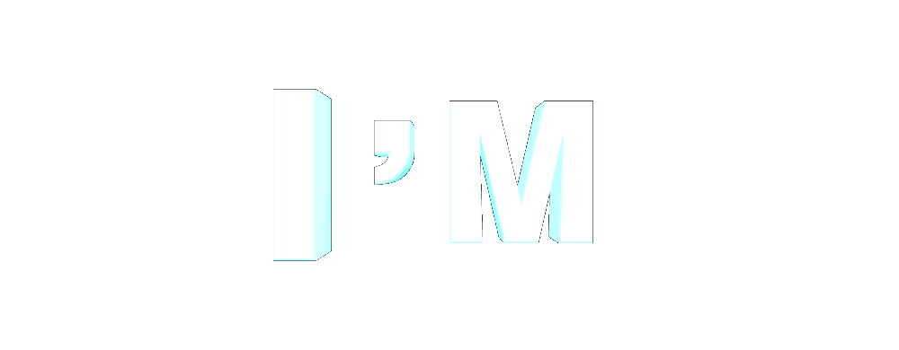
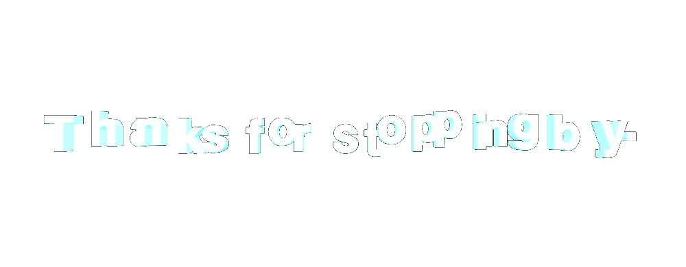

<!-- ═══════════════════════════════════════════════════════════════ -->

<!--                           HERO                                 -->

<!-- ═══════════════════════════════════════════════════════════════ -->

  

  

  

  

  

  

 

<!-- ═══════════════════════════════════════════════════════════════ -->

<!--                         ABOUT ME                               -->

<!-- ═══════════════════════════════════════════════════════════════ -->

<h2>🧑‍💻 About Me</h2>

  🎓 
  <b>Fresh Graduate</b> 
  BS Information Technology

  🌐 
  <b>Web Development</b> 
  Frontend & Backend

  🌱 
  <b>Always Learning</b> 
  Exploring new technologies

  <i>Building projects, exploring new technologies, and turning ideas into functional web applications.</i>

 

<!-- ═══════════════════════════════════════════════════════════════ -->

<!--                       WHAT I BUILD                             -->

<!-- ═══════════════════════════════════════════════════════════════ -->

<h2>🚀 What I Build</h2>

  🌐 
  <b>Web Applications</b> 
  Responsive and functional web experiences built around real use cases.

  ⚙️ 
  <b>Backend Systems</b> 
  Authentication, APIs, databases, CRUD systems and application logic.

  🎨 
  <b>User Interfaces</b> 
  Clean interfaces with usability, structure and visual identity.

 

<!-- ═══════════════════════════════════════════════════════════════ -->

<!--                        TECH STACK                              -->

<!-- ═══════════════════════════════════════════════════════════════ -->

<h2>🛠️ Tech Stack</h2>

<h3>💻 Languages</h3>

  

<h3>⚛️ Frameworks & Libraries</h3>

  

<h3>🗄️ Databases</h3>

  

<h3>🔧 Tools</h3>

  

 

<!-- ═══════════════════════════════════════════════════════════════ -->

<!--                      GITHUB DASHBOARD                          -->

<!-- ═══════════════════════════════════════════════════════════════ -->

<h2>📊 GitHub Dashboard</h2>

  
  

 

  

 

<!-- ═══════════════════════════════════════════════════════════════ -->

<!--                    CONTRIBUTION SNAKE                          -->

<!-- ═══════════════════════════════════════════════════════════════ -->

<h2>🐍 Contribution Activity</h2>

  

 

<!-- ═══════════════════════════════════════════════════════════════ -->

<!--                       CODING MODE                              -->

<!-- ═══════════════════════════════════════════════════════════════ -->

<h2>💻 Coding Mode</h2>

  

  <code>STATUS: ONLINE</code>
  &nbsp;&nbsp;
  <code>MODE: BUILDING</code>
  &nbsp;&nbsp;
  <code>BUGS: PROBABLY</code>

 

<!-- ═══════════════════════════════════════════════════════════════ -->

<!--                       CURRENTLY LEARNING                       -->

<!-- ═══════════════════════════════════════════════════════════════ -->

<h2>📖 Currently Learning</h2>

<table align="center">
  <tr>
    <td align="center">
      🔥 
      <b>Advanced Laravel</b> 
      APIs • Security • Authentication
    </td>
    <td align="center">
      ⚡ 
      <b>Next.js</b> 
      Fullstack React • Server-side Development
    </td>
    <td align="center">
      🎨 
      <b>UI/UX</b> 
      Design Fundamentals • User Experience
    </td>
  </tr>
</table>

 

<!-- ═══════════════════════════════════════════════════════════════ -->

<!--                         Feels                                   -->

<!-- ═══════════════════════════════════════════════════════════════ -->

<h2>⚖️ H̷̸̶̴̢͢ę̷̸̶̴͢l̷̸̶̴̢͢l̷̸̶̴̨͢o̷̸̶̴̢͢ W̷̸̶̴̢͢ǫ̷̸̶̴͢r̷̸̶̴̢͢l̷̸̶̴̨͢d̷̸̶̴̢͢</h2>

 

<!-- ═══════════════════════════════════════════════════════════════ -->

<!--                       CONNECT                                  -->

<!-- ═══════════════════════════════════════════════════════════════ -->

<h2>📫 Connect With Me</h2>

 

 

  

  

