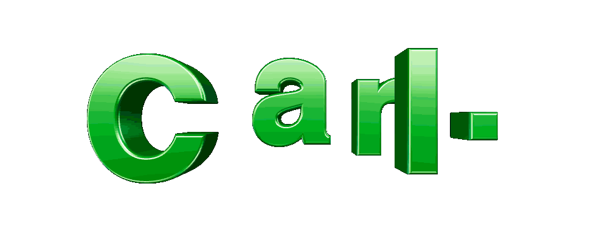
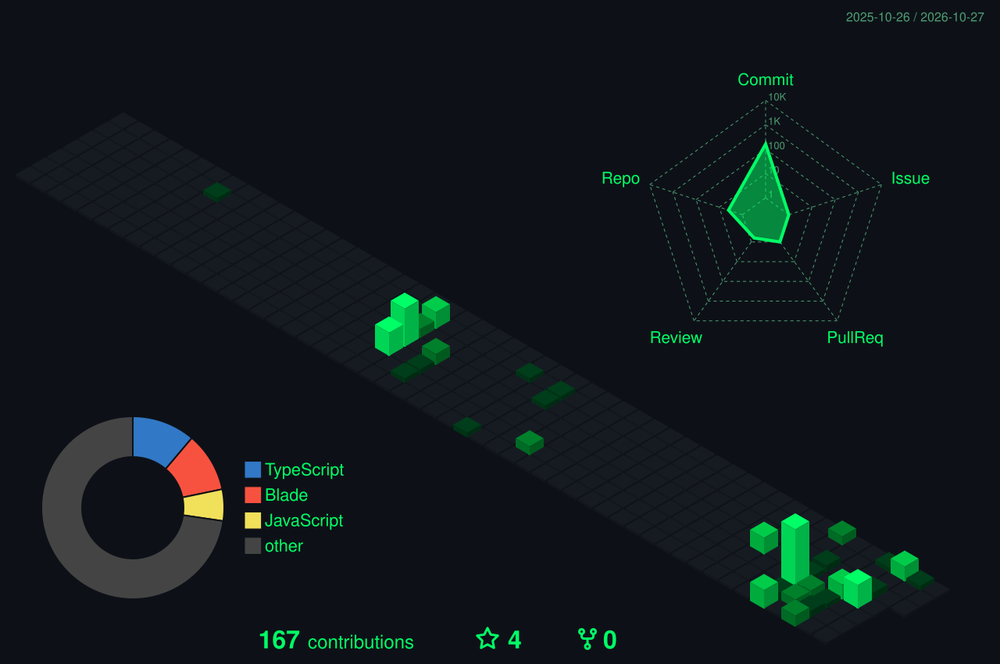
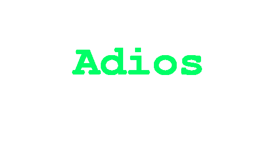

<div align="center">
  <!-- HERO -->

  
  
  

  

  <p>
    
  </p>

  <p>
    
  </p>

  <p>
    
  </p>

  <!-- ABOUT ME -->

  <h2>About Me</h2>

  <p>
    <b>Fresh Graduate</b><br />
    <sub>BS Information Technology</sub>
  </p>

  <p>
    <b>Web Development</b><br />
    <sub>Frontend & Backend</sub>
  </p>

  <p>
    <b>Always Learning</b><br />
    <sub>Exploring new technologies</sub>
  </p>

  <p>
    <i
      >Building projects, exploring new technologies, and turning ideas into functional web
      applications.</i
    >
  </p>

  <!-- WHAT I BUILD -->

  <h2>What I Build</h2>

  <p>
    <b>Web Applications</b><br />
    <sub>Responsive and functional web experiences built around real use cases.</sub>
  </p>

  <p>
    <b>Backend Systems</b><br />
    <sub>Authentication, APIs, databases, CRUD systems and application logic.</sub>
  </p>

  <p>
    <b>User Interfaces</b><br />
    <sub>Clean interfaces with usability, structure and visual identity.</sub>
  </p>

  <!-- TECH STACK -->

  <h2>Tech Stack</h2>

  <h3>Languages</h3>

  <p>
    
  </p>

  <h3>Frameworks & Libraries</h3>

  <p>
    
  </p>

  <h3>Databases</h3>

  <p>
    
  </p>

  <h3>Tools</h3>

  <p>
    
  </p>

  <!-- GITHUB DASHBOARD -->

  <h2>GitHub Dashboard</h2>

  <p>
    
  </p>

  <!--
<p>
  
  
</p>

<p>
  
</p>
-->

  <!-- CONTRIBUTION SNAKE -->

  <h2>Yummers</h2>

  <p>
    
  </p>

  <!-- CODING MODE -->

  <h2>Coding Mode</h2>

  <p>
    
  </p>

  <p>
    <code>STATUS: ONLINE</code>
    &nbsp;&nbsp;
    <code>MODE: BUILDING</code>
    &nbsp;&nbsp;
    <code>BUGS: PROBABLY</code>
  </p>

  <!-- CURRENTLY LEARNING -->

  <h2>Currently Learning</h2>

  <table align="center">
    <tr>
      <td align="center">
        <b>Advanced Laravel</b><br />
        <sub>APIs • Security • Authentication</sub>
      </td>
      <td align="center">
        <b>Next.js</b><br />
        <sub>Fullstack React • Server-side Development</sub>
      </td>
      <td align="center">
        <b>UI/UX</b><br />
        <sub>Design Fundamentals • User Experience</sub>
      </td>
    </tr>
  </table>

  <!-- FEELS -->

  <h2>H̷̸̶̴̢͢ę̷̸̶̴͢l̷̸̶̴̢͢l̷̸̶̴̨͢o̷̸̶̴̢͢ W̷̸̶̴̢͢ǫ̷̸̶̴͢r̷̸̶̴̢͢l̷̸̶̴̨͢d̷̸̶̴̢͢</h2>


  <!-- CONNECT -->

  <h2>Call Me Maybe?</h2>

  <p>
    <a href="mailto:carloaalbao@gmail.com">
      
    </a>
  </p>

  

  <p>
    
  </p>

  
</div>
```
